  

  
  

## Hey, I'm Tim.

I like to **test the limits of AI** — not just what it can generate, but what it can *actually accomplish*. I'm drawn to messy problems, scattered information, and repetitive work that shouldn't have to stay complicated.

I like to **turn data into clarity**, **turn friction into useful solutions**, and **turn repeatable tasks into automations**. Sometimes that's a small tool that saves a few clicks. Sometimes it's a bigger system that connects the dots.

> **My favorite question:** “There has to be a better way to do this. What if I built it?”

### How I think

`Spot the problem` → `Understand the data` → `Build a solution` → `Automate the boring parts` → `Test & improve`

- **Push AI beyond the demo.** Explore local models, agents, tool use, delegation, and where automation still needs good judgment.
- **Make information useful.** Build dashboards, calculators, and research tools that make complicated decisions easier.
- **Solve real workflow problems.** Look for bottlenecks, simplify the experience, and automate what can be reliably repeated.
- **Keep experimenting.** Prototype, break things safely, learn, and turn what works into something practical.

### A few things I've built

| Project | The problem I'm tackling |
| :-- | :-- |
| **[MetrologyBase](https://github.com/timwong930/metrologybase)** | Making calibration and metrology easier to navigate with practical guides, calculators, and vendor-neutral research. |
| **[Chrome Macro Recorder](https://github.com/timwong930/chrome-macro-recorder)** | Reducing repetitive browser work by recording and replaying multi-page workflows. |
| **[Budgeting App](https://github.com/timwong930/Budgeting-App)** | Bringing budgeting, portfolio tracking, watchlists, and financial information into one iOS experience. |

### What I'm exploring

`Local-first AI` · `Multi-agent workflows` · `Useful automations` · `Data-driven tools` · `Thoughtful product design`

I enjoy experimenting with tools like **Python, Swift/SwiftUI, JavaScript, GitHub, and local LLMs** — choosing what fits the problem instead of chasing a stack for its own sake.

---

  <strong>Build small. Learn fast. Make it useful.</strong> 
  More experiments and projects are always in progress.

