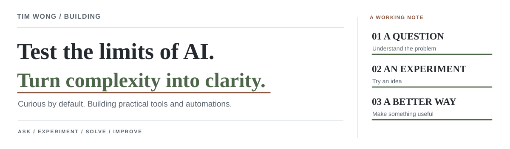
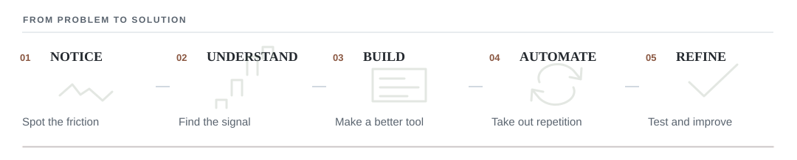
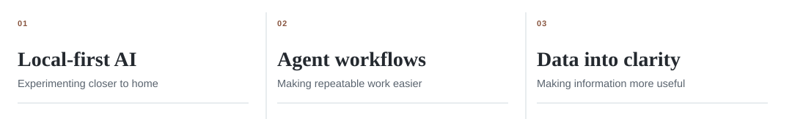
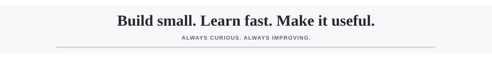

  <picture>
    <source media="(max-width: 640px) and (prefers-reduced-motion: reduce) and (prefers-color-scheme: dark)" srcset="./assets/gh-studio-v6-banner-mobile-dark-static.svg" />
    <source media="(max-width: 640px) and (prefers-reduced-motion: reduce)" srcset="./assets/gh-studio-v6-banner-mobile-light-static.svg" />
    <source media="(prefers-reduced-motion: reduce) and (prefers-color-scheme: dark)" srcset="./assets/gh-studio-v6-banner-desktop-dark-static.svg" />
    <source media="(prefers-reduced-motion: reduce)" srcset="./assets/gh-studio-v6-banner-desktop-light-static.svg" />
    <source media="(max-width: 640px) and (prefers-color-scheme: dark)" srcset="./assets/gh-studio-v6-banner-mobile-dark-animated.svg" />
    <source media="(max-width: 640px)" srcset="./assets/gh-studio-v6-banner-mobile-light-animated.svg" />
    <source media="(prefers-color-scheme: dark)" srcset="./assets/gh-studio-v6-banner-desktop-dark-animated.svg" />
    
  </picture>

  <a href="https://github.com/timwong930?tab=repositories"><strong>Browse projects</strong></a>
  &nbsp;&nbsp; / &nbsp;&nbsp;
  <a href="https://github.com/timwong930/metrologybase"><strong>Explore MetrologyBase</strong></a>

## Hey, I'm Tim.

I like to **test the limits of AI**. I'm interested in what it can *actually accomplish*, not just what it can generate. I'm drawn to messy problems, scattered information, and repetitive work that shouldn't have to stay complicated.

I like to **turn data into clarity**, **turn friction into useful solutions**, and **turn repeatable tasks into automations**. Sometimes that's a small tool that saves a few clicks. Sometimes it's a bigger system that connects the dots.

> **My favorite question:** “There has to be a better way to do this. What if I built it?”

### How I think

  <picture>
    <source media="(max-width: 640px) and (prefers-reduced-motion: reduce) and (prefers-color-scheme: dark)" srcset="./assets/gh-studio-v6-process-mobile-dark-static.svg" />
    <source media="(max-width: 640px) and (prefers-reduced-motion: reduce)" srcset="./assets/gh-studio-v6-process-mobile-light-static.svg" />
    <source media="(prefers-reduced-motion: reduce) and (prefers-color-scheme: dark)" srcset="./assets/gh-studio-v6-process-desktop-dark-static.svg" />
    <source media="(prefers-reduced-motion: reduce)" srcset="./assets/gh-studio-v6-process-desktop-light-static.svg" />
    <source media="(max-width: 640px) and (prefers-color-scheme: dark)" srcset="./assets/gh-studio-v6-process-mobile-dark-animated.svg" />
    <source media="(max-width: 640px)" srcset="./assets/gh-studio-v6-process-mobile-light-animated.svg" />
    <source media="(prefers-color-scheme: dark)" srcset="./assets/gh-studio-v6-process-desktop-dark-animated.svg" />
    
  </picture>

- **Push AI beyond the demo.** Explore local models, agents, tool use, delegation, and where automation still needs good judgment.
- **Make information useful.** Build dashboards, calculators, and research tools that make complicated decisions easier.
- **Solve real workflow problems.** Look for bottlenecks, simplify the experience, and automate what can be reliably repeated.
- **Keep experimenting.** Prototype, break things safely, learn, and turn what works into something practical.

### A few things I've built

| Project | The problem I'm tackling |
| :-- | :-- |
| **[MetrologyBase](https://github.com/timwong930/metrologybase)** | My solution for understanding metrology more deeply and applying what I learn. I turn technical concepts into practical guides, calculators, and equipment comparisons to connect theory with real-world calibration decisions. |
| **[Budgeting App](https://github.com/timwong930/Budgeting-App)** | Bringing budgeting, portfolio tracking, watchlists, and financial information into one iOS experience. |

### What I'm exploring

  <picture>
    <source media="(max-width: 640px) and (prefers-color-scheme: dark)" srcset="./assets/gh-editorial-v4-focus-mobile-dark.svg" />
    <source media="(max-width: 640px)" srcset="./assets/gh-editorial-v4-focus-mobile-light.svg" />
    <source media="(prefers-color-scheme: dark)" srcset="./assets/gh-editorial-v4-focus-desktop-dark.svg" />
    
  </picture>

I am especially interested in **local-first AI**, **multi-agent workflows**, **useful automations**, **data-driven tools**, and **thoughtful product design**.

I enjoy experimenting with tools like **Python, Swift/SwiftUI, JavaScript, GitHub, and local LLMs**, choosing what fits the problem instead of chasing a stack for its own sake.

---

  <picture>
    <source media="(max-width: 640px) and (prefers-reduced-motion: reduce) and (prefers-color-scheme: dark)" srcset="./assets/gh-studio-v6-footer-mobile-dark-static.svg" />
    <source media="(max-width: 640px) and (prefers-reduced-motion: reduce)" srcset="./assets/gh-studio-v6-footer-mobile-light-static.svg" />
    <source media="(prefers-reduced-motion: reduce) and (prefers-color-scheme: dark)" srcset="./assets/gh-studio-v6-footer-desktop-dark-static.svg" />
    <source media="(prefers-reduced-motion: reduce)" srcset="./assets/gh-studio-v6-footer-desktop-light-static.svg" />
    <source media="(max-width: 640px) and (prefers-color-scheme: dark)" srcset="./assets/gh-studio-v6-footer-mobile-dark-animated.svg" />
    <source media="(max-width: 640px)" srcset="./assets/gh-studio-v6-footer-mobile-light-animated.svg" />
    <source media="(prefers-color-scheme: dark)" srcset="./assets/gh-studio-v6-footer-desktop-dark-animated.svg" />
    
  </picture>

